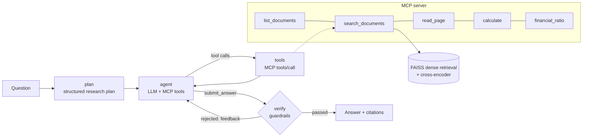

# DocAgent: an agentic RAG analyst for SEC filings

DocAgent answers questions about companies' financial filings (10-K, 10-Q, 8-K, earnings
releases) with figures you can check. A **LangGraph** agent plans the research, retrieves through
tools exposed by its own **MCP server** (search, page reader, calculator, ratio library), and has
to pass **citation and number guardrails** before any answer leaves the system. It runs entirely on
a laptop with a **free local open-weight LLM** (via Ollama), is evaluated on all 150 open-source
**FinanceBench** questions against a plain-RAG **LangChain** baseline, and is served with
**FastAPI** in a Docker image.

**Demo (recorded results, every question browsable):** https://rudrak1404.github.io/DocAgent/



## Results

### Retrieval (no LLM involved)
How often the gold FinanceBench evidence page is retrieved, over one shared index of all 84
filings (33,424 chunks). The configuration was **chosen on a dev half** of the questions (rule
fixed in advance: best mean recall@5) and is reported on the **held-out test half** (75 questions).

| retrieval | recall@1 | recall@5 | recall@10 | MRR@10 |
|---|---|---|---|---|
| BM25 | 8.0% | 13.3% | 22.7% | 0.110 |
| dense, bge-base | 16.0% | 41.3% | 56.0% | 0.271 |
| hybrid BM25 + dense (RRF) | 14.7% | 33.3% | 45.3% | 0.227 |
| dense, bge-base + cross-encoder (bge-reranker-base) | 17.3% | 37.3% | 58.7% | 0.259 |
| dense, bge-large | 21.3% | 46.7% | 61.3% | 0.324 |
| **dense, bge-large + cross-encoder (bge-reranker-v2-m3), chosen** | **26.7%** | **69.3%** | **82.7%** | **0.441** |

* A strong cross-encoder is the biggest lever: +22.6 points of recall@5 over the same retriever
  without it. The smaller re-ranker did not help.
* BM25 does not help on this corpus: questions say "capital expenditure", filings say "purchases of
  property, plant and equipment". Fused with the strong re-ranker it changes nothing; without it,
  it hurts.
* Restricting to the right company adds little on top of the chosen configuration, which matters
  for the agent: it can filter, but it does not depend on guessing the filter right.

All 11 configurations x 3 filter settings, dev/test/all: [`results/retrieval_selection.md`](results/retrieval_selection.md).

### End to end: answers

All 150 questions, one shared store over all 84 filings, graded with FinanceBench's labels. **Both systems use the same free local LLM (Bonsai-2 9B), the same chunks and the same embeddings**, so the difference is the pipeline: planning, MCP tools, re-ranked retrieval and guardrails versus top-5 dense retrieval and one call.

| | DocAgent | plain-RAG baseline |
|---|---|---|
| **accuracy, all questions** | **52.7% (79/150)** | **34.0% (51/150)** |
| accuracy, held-out test half | 53.3% (40/75) | 32.0% (24/75) |
| accuracy, excluding the 10 pilot questions | 52.9% (74/140) | 34.3% (48/140) |
| incorrect (answered, but wrong) | 40 (26.7%) | 44 (29.3%) |
| refusals | 31 | 55 |
| accuracy when it answers | 66.4% | 53.7% |
| faithfulness (claims supported by the evidence it used) | 92.3% | 96.2% |
| evidence includes a gold page (DocAgent: cited; baseline: retrieved) | 63.4% | 41.3% |
| time per question (laptop GPU; DocAgent 2, baseline 3 questions in parallel) | 88 s | 110 s |
| tool calls per question | 5.7 | 0.0 |

| question type (50 each) | DocAgent | baseline |
|---|---|---|
| metrics-generated | 68.0% | 32.0% |
| domain-relevant | 44.0% | 34.0% |
| novel-generated | 46.0% | 36.0% |

* **Paired test (same questions):** DocAgent is right where the baseline is wrong on 40 questions, the reverse on 12; exact McNemar p = 0.00013; accuracy difference +18.7 points (95% bootstrap CI +9.3 to +28.0).
* **Guardrails trade recall for precision:** 16 answers were withheld because a citation or figure could not be verified. Graded anyway, 11 would have been correct and 5 incorrect (15 more the agent itself flagged as insufficient evidence). Returning every withheld draft instead would give 62.0% accuracy with 50 incorrect answers, versus 52.7% with 40 as deployed.
* **Judge check:** blind manual grading of 40 judged answers (stratified by system and question type) agrees with the LLM judge on 82.5% of labels (Cohen's kappa 0.72) and on 90.0% of correct-vs-not decisions (kappa 0.80); every disagreement on correctness had the judge stricter (4 cases; sample accuracy 57% by hand vs 48% by the judge), so the accuracies above are, if anything, conservative.
* **Generation health:** DocAgent made 1218 LLM calls (0 stopped at the token limit, 0 re-sampled, 35 old tool results shortened); the baseline made 150 (11 at the limit, 16 re-sampled).
* Per-question answers, verdicts, citations and tool traces: [`results/runs/`](results/runs/) and the [demo page](https://rudrak1404.github.io/DocAgent/); summary: [`results/eval_summary.md`](results/eval_summary.md).

**Reading the results**
* The gain is largest where retrieval and arithmetic matter: on computed metrics DocAgent is right
  68% of the time vs 32%. Top-5 dense retrieval over one store of 84 filings often misses the right
  filing altogether, so the baseline often has nothing to go on and declines (55 refusals).
* DocAgent answers more often (119 vs 95 committed answers) *and* is more accurate when it answers
  (66% vs 54%). Its faithfulness is slightly lower (92% vs 96%), and the gap is mostly in the
  qualitative questions (98% on computed metrics, 88-91% on the others), where it adds interpretive
  claims ("indicating healthy liquidity") that its cited passages do not state; the baseline's
  fewer answers mostly restate a passage.
* The guardrails are a deliberate precision setting: they turn 16 unverifiable drafts into
  refusals, losing 11 correct answers to avoid 5 wrong ones. For a filing analyst a wrong figure
  is worse than "not verified", but the trade-off is shown rather than hidden.
* For context only, not like-for-like (different retrieval, chunking and prompts, 2023 model): the
  FinanceBench paper reports that GPT-4-Turbo with a retrieval system answered incorrectly or
  refused on 81% of its questions.

## How it works

### 1. Data: FinanceBench
[FinanceBench](https://github.com/patronus-ai/financebench) (Islam et al., 2023) open-source
sample: **150 questions over 84 real SEC filings from 32 companies**, each with a human gold
answer and the gold evidence page. A third of the questions need extracted figures, a third need
calculated metrics, and a third are analyst-style reasoning questions. `python -m docagent.data`
downloads the filings and verifies each PDF against the git blob SHA-1 GitHub reports. The PDFs are
not redistributed here.

### 2. Layout-aware extraction (`docagent/ingest/pdf.py`)
Financial statements are tables, often without ruling lines, and plain text extraction can emit
them column by column, separating each label from its numbers. Every page's words are regrouped
into visual rows by vertical position, and a wide horizontal gap becomes a column break:

```
(Millions) | 2018 | 2017 | 2016
Purchases of property, plant and equipment (PP&E) | (1,577) | (1,373) | (1,420)
```

This runs at ~40 ms per page, about 40x faster than PyMuPDF's table finder (~1.7 s per page),
and handles ruled and borderless tables alike. **Validation:** for all 189 gold evidence passages,
the gold page is the best-matching page in our extraction (mean word 3-gram coverage 95.5%), so
page numbering is aligned with FinanceBench.

### 3. Chunking (`docagent/ingest/chunk.py`)
Token windows (350 tokens, 60 overlap) measured with the embedding model's own tokenizer, never
crossing a page, so every citation points to exactly one page. If a window starts inside a table,
the table's column-header row is carried into it, so `(1,373)` still says which year it is.
Each chunk is indexed with a contextual header (company, filing, period, section, page).
84 filings → 12,013 pages → **33,424 chunks**.

### 4. Retrieval (`docagent/retrieval/`)
* Dense: HuggingFace `transformers` BGE encoder ([CLS] pooling, L2-normalised), FAISS inner-product
  index with metadata filters (company, fiscal year, filing type, document) applied *before* ranking.
* Sparse: Okapi BM25, implemented as a precomputed sparse weight matrix (tested against the
  textbook formula), with number-preserving tokenisation; weighted reciprocal rank fusion.
* Re-ranking: a cross-encoder reads the query and each candidate together.
* The configuration was **chosen on a dev split** of the questions and is reported on the held-out
  test split (see results), so the choice does not overfit the evaluation set.

### 5. MCP server (`docagent/mcp_server.py`)
Built on the official MCP Python SDK (v2 `MCPServer`), with typed tools whose Pydantic return types
become output schemas: `list_documents`, `search_documents`, `read_page`, `calculate` (a safe
arithmetic evaluator that walks the expression's syntax tree against a whitelist, so document text
can never execute code), and `financial_ratio` (27 named ratios with fixed definitions, with
averages of opening and closing balances as FinanceBench defines them). The same server runs
in-process for the agent (in-memory MCP transport), is mounted in the API at `/mcp` (Streamable
HTTP), and runs over stdio for Claude Desktop or Claude Code.

### 6. The agent (`docagent/agent/graph.py`)
A LangGraph `StateGraph`: **plan** (a structured research plan: company, period, facts, formula,
queries) → **agent** (the LLM with the MCP tools; every call is a real MCP `tools/call`; returned
passages go into an evidence registry) → **verify** → answer.

**Guardrails** (`docagent/agent/guardrails.py`, deterministic):
1. an answer must cite evidence;
2. every cited `evidence_id` must have been returned by a tool *in this run*;
3. every figure in the answer must appear in the cited evidence or come from a calculator result
   (allowing for rounding, "in millions" style units, and accounting negatives).

A rejected answer goes back to the agent with the specific problems, the evidence ids it actually
received, and which of them contain an unsupported figure; after two retries the system refuses
rather than return an unverified figure. Retrieved text is treated as data, never as instructions.

**LLM backends** (`docagent/agent/llm_local.py`, `docagent/agent/llm.py`), behind one interface:
* **Local (default, free):** an open-weight model served by Ollama with native tool calling and
  JSON-schema outputs. The agent uses **Bonsai-2 9B**, a ternary-weight model built on Qwen3.5 with
  hybrid (mostly linear) attention, so a 32k context costs only 3.8 GB: on the 8 GB laptop GPU it
  runs fully on the GPU next to the retrieval models (~54 tokens/s). Qwen3-8B, tried first, needed
  CPU offload and timed out (>50 min on one question).
  * **Decoding:** reasoning calls use the model's own recommended sampling (Qwen3.5: temperature
    1.0, top-p 0.95, top-k 20, presence penalty) with a fixed seed per attempt for reproducibility.
    A turn that runs into the token limit while still reasoning is re-sampled with a new seed.
  * **Context fitting:** tool results are trimmed for the model, and when the conversation nears
    the 32k window the *oldest* results are shortened to their evidence ids, sources and a snippet
    (the latest result is never touched). Ollama otherwise silently drops the start of an
    over-long prompt, i.e. the question. The evidence registry keeps every full text, so shortened
    ids stay citable and the guardrails still check against the full text.
  * **Serving:** Ollama with flash attention and an 8-bit KV cache, and one cache slot per
    concurrently running question. With a single shared slot, interleaved conversations evicted
    each other's cached prompt, so every agent turn re-read its whole history (7.5 s for 13k
    tokens); with a slot each, a turn only processes its new tokens (0.7 s). Both systems use the
    same engine settings.
* **Claude (optional):** the official Anthropic SDK with adaptive thinking, prompt caching of the
  growing conversation, and server-side refusal fallback (`DOCAGENT_LLM_PROVIDER=anthropic`).

### 7. Baseline (`docagent/baseline.py`)
Plain RAG in LangChain: FAISS vector store with `HuggingFaceEmbeddings`, top-5 chunks from one
shared store, a prompt template, one LLM call. It uses the same chunks, embedding vectors and LLM
as DocAgent, so the comparison isolates the pipeline. This is FinanceBench's "shared vector store"
setting.

### 8. Evaluation (`docagent/evaluation.py`)
* **Correctness:** an LLM judge applies FinanceBench's labels (correct / incorrect / refusal), with
  explicit rules for rounding and units, given the question, gold answer and gold justification.
  The judge is **Qwen3-8B** (thinking on, its recommended sampling, re-asked if its verdict does not
  parse). It is *not* independent of the agent's model family (Bonsai-2 is built on Qwen3.5), but
  both systems' answers come from the same LLM, so any shared bias applies to both alike, and the
  judge is checked against **blind manual grading** of a sample stratified by system and question
  type (drawn without looking at the judge, graded without seeing its label). Answers the system
  itself refused are labelled *refusal* by rule.
* **Faithfulness:** the answer is split into atomic claims and each is checked against the evidence
  *that system used*.
* **Citation accuracy:** the share of answers whose evidence includes a gold evidence page.
* **Statistics:** paired exact McNemar test and a bootstrap CI for the accuracy difference;
  breakdown by question type; held-out test split; results excluding the 10 pilot questions.

### 9. What the first full run caught
The first complete run (kept in `results/runs/v1_greedy/`) was thrown away after checking its
generation logs, because three bugs, not the systems, drove its numbers:

| bug | symptom in the logs | fix |
|---|---|---|
| Greedy decoding (temperature 0) of Qwen-family reasoning models | 34 of 150 baseline answers **empty**: the reasoning looped ("Wait, ...") until the 4,096-token limit; the judge looped too and crashed mid-batch | the model's recommended sampling + fixed seeds; re-sample a runaway turn; a judge failure is retried, never fatal |
| Agent conversation outgrew the 16k window | 71 agent calls stopped at the window limit; 19 of the agent's 46 refusals came from those questions | 32k window (hybrid attention keeps it cheap) + shortening the oldest tool results |
| Judge filed non-answers under *incorrect* | refusals undercounted, "hallucinations" overcounted | refusal precedence in the judge prompt; system refusals labelled by rule |

The guardrail also flagged formula constants (the "x 100" of a percentage) in the stated
calculation as unsupported figures; such conversion constants are now allowed in the calculation,
while the answer's own figures are checked exactly as before. Everything was then re-run from
scratch with the same questions, prompts and retrieval. The report's "generation health" line
shows how often the fixes were needed.

## Run it

```bash
python -m venv .venv && .venv/Scripts/activate        # or: source .venv/bin/activate
pip install -e ".[dev]"
ollama pull bonsai-2:9b && ollama pull qwen3:8b        # agent + judge (free, local)

python -m docagent.data                                # 150 questions + 84 filings (verified)
python -m docagent.ingest.build                        # parse -> validate -> chunk -> embed -> index
python -m docagent.retrieval.select                    # retrieval ablation and selection
python -m pytest -q                                    # offline tests (no LLM needed)

python -m docagent.evaluation run --system agent       # resumable
python -m docagent.evaluation run --system baseline
python -m docagent.evaluation judge --system agent && python -m docagent.evaluation judge --system baseline
python -m docagent.evaluation audit-sample             # blind sample -> grade into results/judge_audit_manual.json
python -m docagent.evaluation report
python deploy/build_pages.py                           # static results site (docs/)

uvicorn docagent.api.app:create_app --factory --port 8080   # web UI + /ask + /search + /mcp
```

**Use the MCP server from Claude Desktop / Claude Code** (stdio):

```json
{ "mcpServers": { "docagent": { "command": "python", "args": ["-m", "docagent.mcp_server"],
                                "cwd": "/path/to/DocAgent" } } }
```

**Over HTTP** (the API mounts it at `/mcp`; send `X-API-Key` if `DOCAGENT_API_KEY` is set):

```python
from mcp import Client
from mcp.client.streamable_http import create_mcp_http_client, streamable_http_client

transport = streamable_http_client("http://localhost:8080/mcp",
                                   http_client=create_mcp_http_client(headers={"X-API-Key": "<key>"}))
async with Client(transport) as c:
    r = await c.call_tool("search_documents", {"query": "purchases of property, plant and equipment",
                                               "company": "3M", "fiscal_year": 2018})
```

**Docker:** `docker build -t docagent .` then `docker run -p 8080:8080 docagent` (point
`OLLAMA_HOST` at an Ollama server for live answers). `deploy/cloudrun.sh` deploys the same image to
Google Cloud Run for anyone with a GCP billing account.

## Limitations
* The corpus is the 84 filings behind the open-source questions, not all SEC filings.
* A 9B local model is far weaker than frontier models at multi-step financial reasoning; the
  framework is model-agnostic and the Claude backend is a configuration switch.
* Questions are used exactly as FinanceBench provides them. 3 of the 150 name no company at all
  (e.g. "Was there any drop in Cash & Cash equivalents between FY 2023 and Q2 of FY2024?"), which
  makes them unanswerable from a shared store; others use aliases (AMEX, JnJ) that the agent resolves.
* Two generic prompt rules (follow a metric definition the question gives; answer every part of the
  question) were added after a 10-question pilot, so results excluding those questions are reported.
  The fixes in section 9 are generic engineering fixes found in the generation logs of a full run;
  they change no agent or baseline prompt and no retrieval setting.
* The LLM judge is itself a model, from the same family as the agent's base model; its agreement
  with blind manual grading is reported.
* The demo site is static (recorded answers). A CPU-only host would also need the re-ranker
  switched off (`--build-arg RETRIEVAL_MODE=dense`), since a 568M-parameter cross-encoder on CPU adds
  minutes per search.
* Data: FinanceBench is released by Patronus AI; check its terms before redistributing.

## License
MIT (code). See FinanceBench for the dataset's terms.
