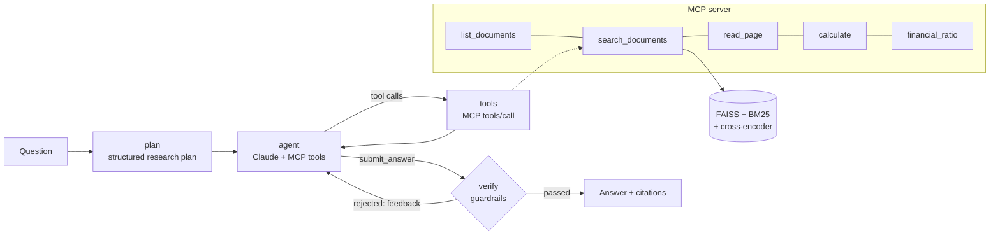

# DocAgent: an agentic RAG analyst for SEC filings

DocAgent answers questions about companies' financial filings (10-K, 10-Q, 8-K, earnings
releases) with figures you can check. A **LangGraph** agent plans the research, retrieves through
tools exposed by its own **MCP server** (hybrid search, page reader, calculator, ratio library),
and has to pass **citation and number guardrails** before any answer leaves the system. It is
evaluated on **FinanceBench** against a plain-RAG **LangChain** baseline, and served with
**FastAPI** in a Docker image deployed to **Google Cloud Run**.



## Results

### Retrieval (no LLM involved)
How often the gold FinanceBench evidence page is retrieved, over one shared index of all 84
filings (33,424 chunks). The configuration was **chosen on a dev half** of the questions (rule
fixed in advance: best mean recall@5) and is reported on the **held-out test half** (75 questions).

| retrieval | recall@1 | recall@5 | recall@10 | MRR@10 |
|---|---|---|---|---|
| BM25 | 8.0% | 13.3% | 22.7% | 0.110 |
| dense, bge-base | 16.0% | 41.3% | 56.0% | 0.271 |
| hybrid BM25 + dense (RRF) | 14.7% | 33.3% | 45.3% | 0.227 |
| dense, bge-base + cross-encoder (bge-reranker-base) | 17.3% | 37.3% | 58.7% | 0.259 |
| dense, bge-large | 21.3% | 46.7% | 61.3% | 0.324 |
| **dense, bge-large + cross-encoder (bge-reranker-v2-m3), chosen** | **26.7%** | **69.3%** | **82.7%** | **0.441** |

* A strong cross-encoder is the biggest lever: +22.6 points of recall@5 over the same retriever
  without it. The smaller re-ranker did not help.
* BM25 does not help on this corpus: questions say "capital expenditure", filings say "purchases of
  property, plant and equipment". Fused with the strong re-ranker it changes nothing; without it,
  it hurts.
* Restricting to the right company adds little on top of the chosen configuration, which matters
  for the agent: it can filter, but it does not depend on guessing the filter right.

All 11 configurations x 3 filter settings, dev/test/all: [`results/retrieval_selection.md`](results/retrieval_selection.md).

### End-to-end question answering
DocAgent vs. the LangChain plain-RAG baseline on all 150 questions (accuracy, faithfulness,
citation hits, cost, latency) is produced by `docagent/evaluation.py` into
`results/eval_summary.md`. The harness has been verified end to end; the Claude-graded run has not been made yet.

## How it works

### 1. Data: FinanceBench
[FinanceBench](https://github.com/patronus-ai/financebench) (Islam et al., 2023) open-source
sample: **150 questions over 84 real SEC filings from 32 companies**, each with a human gold
answer and the gold evidence page. A third of the questions need extracted figures, a third need
calculated metrics, and a third are analyst-style reasoning questions. `python -m docagent.data` downloads the
filings and verifies each PDF against the git blob SHA-1 GitHub reports. The PDFs are not
redistributed here.

### 2. Layout-aware extraction (`docagent/ingest/pdf.py`)
Financial statements are tables, often without ruling lines, and plain text extraction can emit
them column by column, separating each label from its numbers. Every page's words are regrouped
into visual rows by vertical position, and a wide horizontal gap becomes a column break:

```
(Millions) | 2018 | 2017 | 2016
Purchases of property, plant and equipment (PP&E) | (1,577) | (1,373) | (1,420)
```

This runs at ~40 ms per page, about 40x faster than PyMuPDF's table finder (~1.7 s per page),
and handles ruled and borderless tables alike. **Validation:** for all 189 gold evidence passages,
the gold page is the best-matching page in our extraction (mean word 3-gram coverage 95.5%), so
page numbering is aligned with FinanceBench.

### 3. Chunking (`docagent/ingest/chunk.py`)
Token windows (350 tokens, 60 overlap) measured with the embedding model's own tokenizer, never
crossing a page, so every citation points to exactly one page. If a window starts inside a table,
the table's column-header row is carried into it, so `(1,373)` still says which year it is.
Each chunk is indexed with a contextual header (company, filing, period, section, page).
84 filings → 12,013 pages → **33,424 chunks**.

### 4. Retrieval (`docagent/retrieval/`)
* Dense: HuggingFace `transformers` BGE encoder ([CLS] pooling, L2-normalised), FAISS inner-product
  index with metadata filters (company, fiscal year, filing type, document) applied *before* ranking.
* Sparse: Okapi BM25, implemented as a precomputed sparse weight matrix (tested against the
  textbook formula), with number-preserving tokenisation.
* Fusion and re-ranking: weighted reciprocal rank fusion and a cross-encoder re-ranker.
* The configuration was **chosen on a dev split** of the questions and is reported on the held-out
  test split (see results), so the choice does not overfit the evaluation set.

### 5. MCP server (`docagent/mcp_server.py`)
Built on the official MCP Python SDK (v2 `MCPServer`), with typed tools whose Pydantic return types
become output schemas: `list_documents`, `search_documents`, `read_page`, `calculate` (a safe
arithmetic evaluator that walks the expression's syntax tree against a whitelist, so document text
can never execute code), and `financial_ratio` (27 named ratios with fixed definitions, with averages of opening and
closing balances as FinanceBench defines them). The same server runs in-process for the agent
(in-memory MCP transport), is mounted in the API at `/mcp` (Streamable HTTP), and runs over stdio
for Claude Desktop or Claude Code.

### 6. The agent (`docagent/agent/graph.py`)
A LangGraph `StateGraph`: **plan** (Claude writes a structured research plan) → **agent** (Claude with
the MCP tools; every call is a real MCP `tools/call`; returned passages go into an evidence
registry) → **verify** → answer. Claude is called through the official Anthropic SDK: adaptive
thinking with `effort`, prompt caching of the growing conversation, and server-side refusal
fallback enabled and logged.

**Guardrails** (`docagent/agent/guardrails.py`, deterministic):
1. an answer must cite evidence;
2. every cited `evidence_id` must have been returned by a tool *in this run*;
3. every figure in the answer must appear in the cited evidence or come from a calculator result
   (allowing for rounding, "in millions" style units, and accounting negatives).

A rejected answer goes back to the agent with the specific problems; after two retries the system
refuses rather than return an unverified figure. Retrieved text is treated as data, never as
instructions.

### 7. Baseline (`docagent/baseline.py`)
Plain RAG in LangChain: FAISS vector store with `HuggingFaceEmbeddings`, top-5 chunks from one
shared store, a prompt template, one LLM call. It uses the same chunks, embedding vectors and
Claude model as DocAgent, so the comparison isolates the pipeline. This is FinanceBench's "shared
vector store" setting.

### 8. Evaluation (`docagent/evaluation.py`)
* **Correctness:** an LLM judge applies FinanceBench's labels (correct / incorrect / refusal), with
  explicit rules for rounding and units, given the question, gold answer and gold justification.
* **Faithfulness:** the answer is split into atomic claims and each is checked against the evidence
  *that system used*.
* **Citation accuracy:** the share of answers with at least one citation on a gold evidence page.
* **Statistics:** paired exact McNemar test and a bootstrap CI for the accuracy difference;
  breakdown by question type; held-out test split; cost and latency per question.

## Run it

```bash
python -m venv .venv && .venv/Scripts/activate        # or: source .venv/bin/activate
pip install -e ".[dev]"
cp .env.example .env                                   # add ANTHROPIC_API_KEY

python -m docagent.data                                # 150 questions + 84 filings (verified)
python -m docagent.ingest.build                        # parse -> validate -> chunk -> embed -> index
python -m docagent.retrieval.select                    # retrieval ablation and selection
python -m pytest -q                                    # offline tests (no API calls)

python -m docagent.evaluation run --system agent --ids pilot
python -m docagent.evaluation run --system baseline
python -m docagent.evaluation run --system agent
python -m docagent.evaluation judge --system baseline && python -m docagent.evaluation judge --system agent
python -m docagent.evaluation report

uvicorn docagent.api.app:create_app --factory --port 8080   # web UI at http://localhost:8080
```

**Use the MCP server from Claude Desktop / Claude Code** (stdio):

```json
{ "mcpServers": { "docagent": { "command": "python", "args": ["-m", "docagent.mcp_server"],
                                "cwd": "/path/to/DocAgent" } } }
```

**Use the hosted MCP endpoint** (Streamable HTTP, API key required):

```python
from mcp import Client
from mcp.client.streamable_http import create_mcp_http_client, streamable_http_client

transport = streamable_http_client("https://<service-url>/mcp",
                                   http_client=create_mcp_http_client(headers={"X-API-Key": "<key>"}))
async with Client(transport) as c:
    r = await c.call_tool("search_documents", {"query": "purchases of property, plant and equipment",
                                               "company": "3M", "fiscal_year": 2018})
```

**Docker / deploy:** `docker build -t docagent .` then `docker run -p 8080:8080 -e ANTHROPIC_API_KEY=...
-e DOCAGENT_API_KEY=... docagent`. Cloud Run (CPU, scales to zero, at most 2 instances, secrets in
Secret Manager): `bash deploy/cloudrun.sh`.

## Limitations
* The corpus is the 84 filings behind the open-source questions, not all SEC filings.
* Questions are used exactly as FinanceBench provides them. 3 of the 150 name no company at all
  (e.g. "Was there any drop in Cash & Cash equivalents between FY 2023 and Q2 of FY2024?"), which
  makes them unanswerable from a shared store; others use aliases (AMEX, JnJ) that the agent resolves.
* The hosted demo runs on CPU-only Cloud Run, where a 568M-parameter cross-encoder would add minutes
  per search, so it serves dense retrieval without re-ranking. The evaluated configuration (with the
  re-ranker) runs on a GPU; `--build-arg RETRIEVAL_MODE=...` builds either.
* The LLM judge is itself a model; a sample of its labels was checked by hand (see results).
* FinanceBench gold answers occasionally use definitions a filing does not state; the agent states
  which line item it used.
* Data: FinanceBench is released by Patronus AI; check its terms before redistributing.

## License
MIT (code). See FinanceBench for the dataset's terms.
